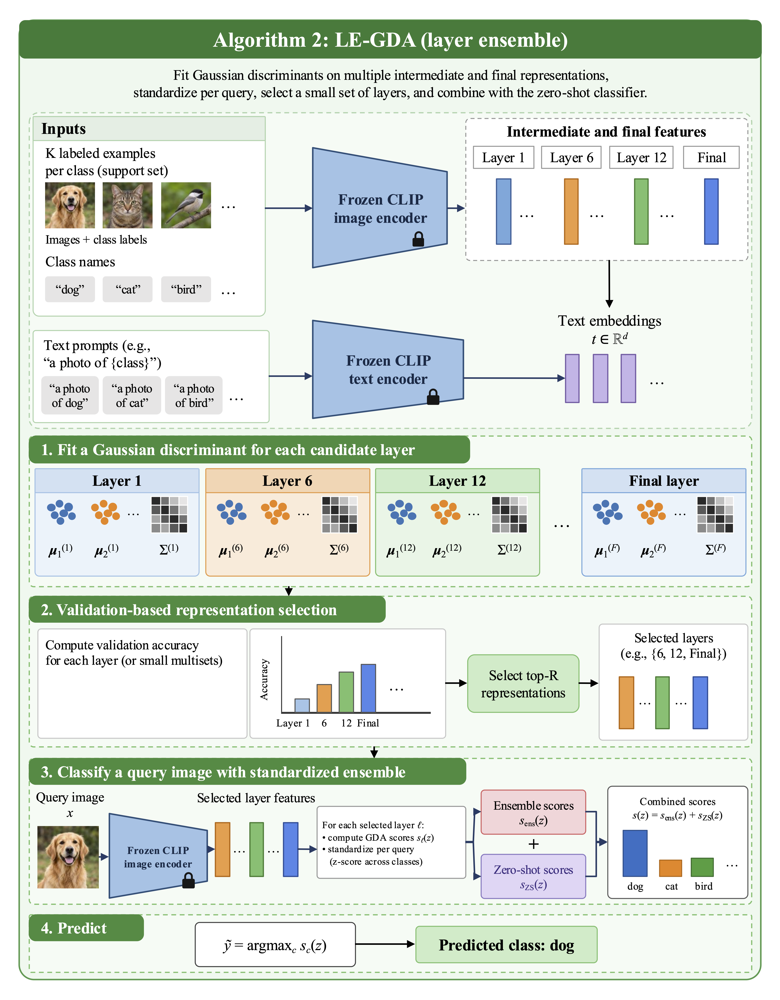
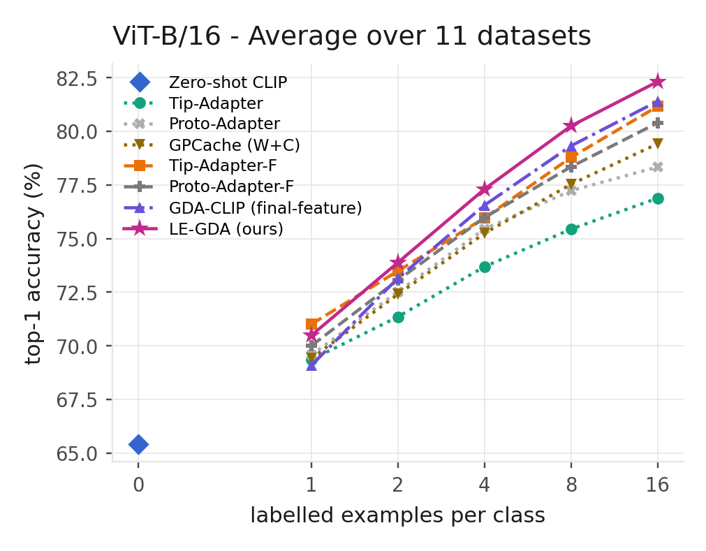
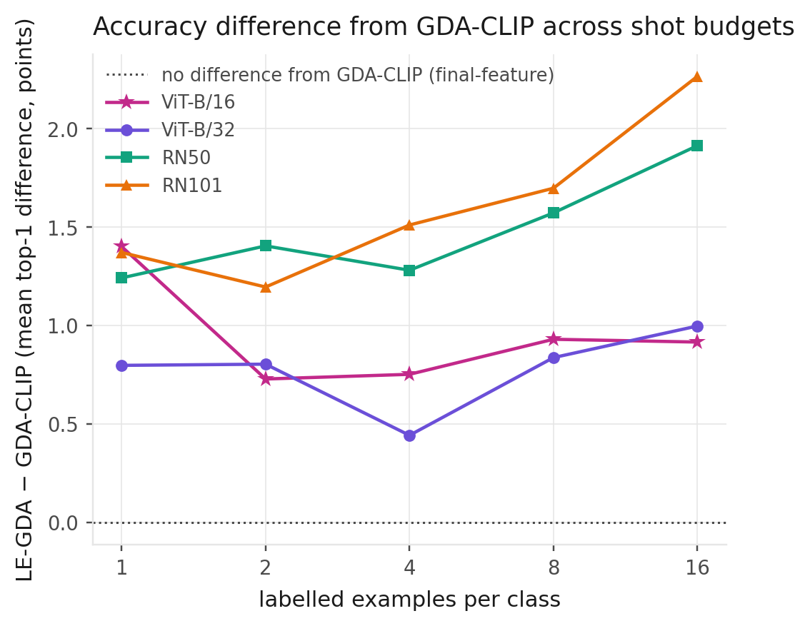

# LE-GDA — Layer-Ensemble Gaussian Discriminant Analysis for Training-Free Few-Shot CLIP

Official code for **"LE-GDA: Layer-Ensemble Gaussian Discriminant Analysis for
Training-Free Few-Shot CLIP"**, accepted at **WACV 2027**.

LE-GDA fits a shared-covariance Gaussian discriminant classifier on several
feature spaces from **one** CLIP forward pass: intermediate transformer blocks
and ResNet stages, as well as the final projected embedding. It standardises
each layer's class scores per query, selects a small set of layers on the
validation split, and adds the result to the zero-shot classifier.

**No trainable parameters. One forward pass. No fine-tuning.**

The intermediate layers are individually *weaker* than the final embedding
(4–7 points lower on ViT models), yet they are still selected and still
improve accuracy when combined with it.

<p align="center">
  
</p>

*LE-GDA pipeline. (1) A Gaussian discriminant is fitted on the features of
each candidate layer. (2) A small set of layers is selected by validation
accuracy. (3) At test time, each selected layer's scores are standardised per
query (z-score across classes), averaged, and added to the zero-shot CLIP
scores. (4) The prediction is the class with the highest combined score.*

---

## Results

16 shots, 11 datasets, 3 seeds, standard CoOp test splits.

**ViT-B/16**

| Method | Caltech | DTD | EuroSAT | FGVC | Food101 | ImageNet | Flowers | Pets | Cars | SUN397 | UCF101 | **Mean** | Training |
|---|---|---|---|---|---|---|---|---|---|---|---|---|---|
| Zero-shot CLIP | 93.27 | 44.03 | 48.49 | 24.81 | 85.88 | 67.84 | 70.81 | 89.10 | 65.55 | 62.56 | 67.41 | **65.43** | — |
| Tip-Adapter | 94.86 | 65.54 | 77.87 | 40.46 | 86.36 | 69.47 | 93.90 | 91.74 | 75.52 | 71.71 | 78.26 | **76.88** | no |
| Proto-Adapter | 95.36 | 67.45 | 79.10 | 38.83 | 86.93 | 70.77 | 95.60 | 92.15 | 79.20 | 74.62 | 81.69 | **78.34** | no |
| GPCache | 95.36 | 69.94 | 83.26 | 43.91 | 86.94 | 70.58 | 96.91 | 92.40 | 78.59 | 74.38 | 81.32 | **79.42** | no |
| Tip-Adapter-F | 95.81 | 72.16 | 87.56 | 45.75 | 87.30 | 71.98 | 96.52 | 92.96 | 82.76 | 76.17 | 83.79 | **81.16** | 20 epochs |
| Proto-Adapter-F | 95.66 | 70.41 | 81.15 | 45.42 | 87.12 | 72.19 | 97.28 | 92.80 | 82.78 | 76.16 | 83.35 | **80.39** | 20 epochs |
| GDA-CLIP | 95.10 | 72.52 | 87.53 | 48.91 | 87.16 | 71.44 | 97.36 | 93.73 | 83.01 | 75.77 | 82.84 | **81.40** | no |
| **LE-GDA (ours)** | 95.84 | 72.12 | 90.55 | 51.94 | 87.12 | 71.36 | 97.90 | 93.66 | 83.36 | 76.50 | 85.10 | **82.31** | no |

**All four backbones**: mean over the 11 datasets, ± one standard deviation over 3 seeds.

| Backbone | GPCache | GDA-CLIP | LE-GDA | LE-GDA − GDA-CLIP |
|---|---|---|---|---|
| ViT-B/16 | 79.42 ± 0.17 | 81.40 ± 0.08 | **82.31 ± 0.05** | **+0.92 ± 0.03** |
| ViT-B/32 | 75.61 ± 0.12 | 77.69 ± 0.11 | **78.69 ± 0.02** | **+1.00 ± 0.11** |
| RN50 | 72.81 ± 0.06 | 75.56 ± 0.15 | **77.47 ± 0.11** | **+1.91 ± 0.06** |
| RN101 | 75.26 ± 0.25 | 77.41 ± 0.22 | **79.68 ± 0.30** | **+2.26 ± 0.24** |

<p align="center">
  
  
</p>

*Left: top-1 accuracy on ViT-B/16, averaged over the 11 datasets, for 0–16
labelled examples per class. Right: LE-GDA's gain over GDA-CLIP (which uses
only the final feature) on all four backbones. The gain is positive at every
shot count.*

LE-GDA has the best 11-dataset mean on all four backbones. It is ahead of both
fine-tuned adapters even though it trains nothing. ImageNet is the exception:
there, the two fine-tuned adapters are ahead of LE-GDA.

The GDA-CLIP row is a *strengthened* baseline. Its covariance estimator is one
point in the ridge grid we search, so this row is at least as strong as the
published method. Most of the gain from zero-shot CLIP to GDA-CLIP comes from
the Gaussian discriminant classifier, which is prior work. LE-GDA's own
contribution is the last column of the table above.

---

## Setup

```bash
git clone https://github.com/pavodi-NM/le-gda.git
cd le-gda

conda create -n legda python=3.10
conda activate legda
pip install torch torchvision          # match your CUDA build
pip install -r requirements.txt
```

Tested with Python 3.10 on a single RTX 4060 (8 GB).

### Data

Set `LEGDA_DATA_ROOT` to the dataset directory (default `./data/tip-adapter`):

```bash
export LEGDA_DATA_ROOT=/path/to/data
python scripts/download_and_prepare.py --weights   # CLIP checkpoints
python scripts/download_and_prepare.py --check     # reports which datasets are ready
```

The 11 datasets use CoOp's directory layout and `split_zhou_*.json` splits.
Follow [CoOp's DATASETS.md](https://github.com/KaiyangZhou/CoOp/blob/main/DATASETS.md),
except for two datasets that have their own scripts:

```bash
python scripts/reconstruct_sun397_from_hf.py   # SUN397: the official hosts are offline
python scripts/fetch_imagenet_subset.py        # ImageNet subset, no account needed
```

> **ImageNet.** The ImageNet test set here is 40 images per class from the
> official validation set. Another 10 per class form the validation split, and
> 32 per class from the training set are the pool the few-shot examples are
> drawn from. All methods use these same splits.

### Feature extraction

```bash
python scripts/download_and_prepare.py --extract
# or one backbone / one dataset at a time:
python scripts/download_and_prepare.py --extract --backbones ViT-B/16 --datasets dtd eurosat
```

This writes the features to `caches/` (about 20 GB, about 1.5 h on an
RTX 4060). If it is interrupted, rerun the same command: files that already
exist are skipped.

---

## Reproducing the results

Run every command from the repository root with `PYTHONPATH=.` set.

```bash
TEN="caltech101 dtd eurosat fgvc food101 oxford_flowers oxford_pets stanford_cars sun397 ucf101"
```

### From the released results (no GPU)

`evidence/` holds the result files that every table and figure in the paper
is generated from.

```bash
python scripts/make_le_gda_head_to_head.py --suffix _testfull   # the tables above
python scripts/rebuild_backbone_main.py                         # main table (LaTeX)
python scripts/make_per_dataset_table.py                        # per-dataset breakdown
python scripts/plot_le_gda_figures.py --strict --suffix _testfull   # accuracy vs. shots
python scripts/plot_le_gda_vs_gda.py                            # gain over GDA-CLIP
```

The figures are written to `figures/le_gda/`.

### From the features (GPU)

```bash
# LE-GDA and GDA-CLIP (ViT; use --backbones ViT-B/32 for the other ViT)
python scripts/run_layer_ensemble.py --backbones ViT-B/16 --datasets $TEN \
    --test-split testfull --out evidence/layer_ensemble_vitb16_testfull.json
python -m scripts.run_nonlinear_fusion --backbones ViT-B/16 --datasets $TEN \
    --out evidence/nonlinear_fusion_full_ViT-B-16.json

# ResNets: the candidate layers are the four stages R1..R4 plus the final embedding
python scripts/run_layer_ensemble.py --backbones RN50 --datasets $TEN \
    --spaces R1 R2 R3 R4 last --test-split testfull \
    --out evidence/layer_ensemble_RN50_testfull.json

# ImageNet is run separately with --test-split test
python scripts/run_layer_ensemble.py --backbones ViT-B/16 --datasets imagenet \
    --test-split test --out evidence/layer_ensemble_imagenet_b16_testfull.json
```

The table and figure scripts look for these exact output filenames. Keep the
names shown here so that the previous section picks the new results up.

---

## Baselines

Every baseline is re-run on the same features, splits, seeds and few-shot
examples as LE-GDA, so the tables compare methods under identical conditions.

| Method | Implementation | Script |
|---|---|---|
| Tip-Adapter / Tip-Adapter-F | original authors' code, adapted to our protocol | `main.py` |
| Proto-Adapter / Proto-Adapter-F | ours, from the paper (no public code exists) | `scripts/run_proto_adapter.py` |
| GPCache | ours | `scripts/run_baselines_e4.py` |
| GDA-CLIP | ours: LE-GDA restricted to the final layer | `scripts/run_layer_ensemble.py` |

The changes to the original Tip-Adapter code are limited to the evaluation
protocol: our data splits and seeded few-shot sampling, no model selection on
the test set, and 3 seeds. The model, loss, optimiser, schedule and
hyperparameter search grid are unchanged. The exact diff is in `patches/`.
Proto-Adapter is implemented from Kato et al., *Sensors* 2024. The docstring
of `scripts/proto_adapter.py` lists every implementation choice the paper
leaves unspecified.

```bash
# Tip-Adapter and Tip-Adapter-F (one call per dataset and backbone, 3 seeds each)
python main.py --config configs/dtd.yaml --backbone ViT-B/16 --seeds 0 1 2 \
    --test-split testfull --out evidence/runB/runB_dtd_ViT-B-16.json

# Proto-Adapter and Proto-Adapter-F
python scripts/run_proto_adapter.py --protocol ours --arms free ft --scale 64 \
    --seeds 0 1 2 --backbones ViT-B/16 --k 16 \
    --out evidence/proto_adapter/ours_ViT-B-16.json

# GPCache
python scripts/run_baselines_e4.py --datasets $TEN --backbones ViT-B/16 \
    --test-split testfull --out evidence/baselines_e4_testfull.json

# 1, 2, 4 and 8 shots for the Tip-Adapter and Proto-Adapter variants
bash scripts/run_jobA_shots.sh
bash scripts/run_jobB_shots.sh
```

---

## Repository structure

```
main.py       Tip-Adapter (original code, adapted to our protocol)
scripts/      feature extraction, LE-GDA, baselines, tables and figures
evidence/     result files behind every number in the paper
configs/      per-dataset settings
datasets/     CoOp-style dataset loaders and splits
clip/         CLIP model (from openai/CLIP)
patches/      diff applied to the original Tip-Adapter code
figures-diagrams/  figures shown in this README
```

## License

MIT, see [LICENSE](LICENSE). The datasets keep their own licences.

## Acknowledgements

This code builds on [Tip-Adapter](https://github.com/gaopengcuhk/Tip-Adapter),
[CLIP](https://github.com/openai/CLIP), [CoOp](https://github.com/KaiyangZhou/CoOp),
[CLIP-Adapter](https://github.com/gaopengcuhk/CLIP-Adapter) and the GDA-CLIP
line of work on training-free discriminant classifiers for CLIP.

## Citation

```bibtex
@inproceedings{legda2027,
  title     = {LE-GDA: Layer-Ensemble Gaussian Discriminant Analysis for
               Training-Free Few-Shot CLIP},
  author    = {Maniamfu, Pavodi Ndoyi and Kiketa, Vogel and Zezina, Kuetu Kuzulu
               and Kabongo, Jaking Mukendi and Kutangila, David Mayoya
               and Honore, Mampuya Kinkani Pescie and L'Or, Sieka Wolo},
  booktitle = {Proceedings of the IEEE/CVF Winter Conference on Applications
               of Computer Vision (WACV)},
  year      = {2027}
}
```
